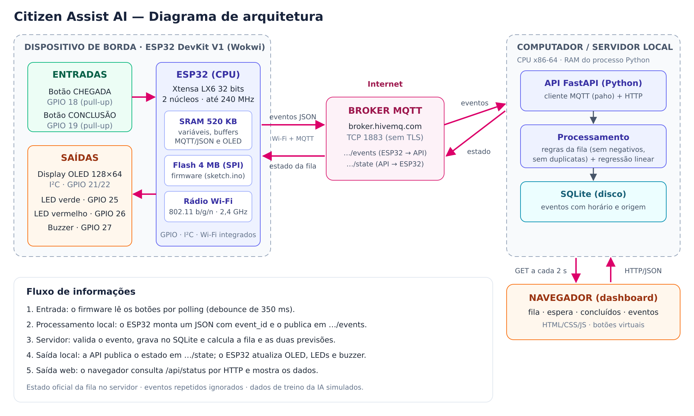

# Citizen Assist AI | Arquitetura e Organização de Computadores

Protótipo educacional de fila virtual: **ESP32 (Wokwi) + MQTT + API FastAPI + SQLite + dashboard web + regressão linear**.

Global Solution 2026.2 · FIAP · Turma 1CC-FEV

> **IMPORTANTE:** os dados usados para treinar a regressão linear são **SINTÉTICOS / SIMULADOS**. O sistema NÃO foi validado com cidadãos reais e não constitui implantação em serviço público.

## Integrantes

| Nome | RM |
|---|---|
| _preencher_ | _preencher_ |
| _preencher_ | _preencher_ |

**Vídeo de demonstração:** _preencher com o link_

## Instalação (Windows PowerShell)

1. Clone o repositório (ou baixe pelo botão **Code > Download ZIP**) e abra a pasta no VS Code.
2. Abra **Terminal > Novo Terminal** e entre na pasta do projeto:

```powershell
cd citizen-assist-ai-arquitetura
```

3. Use Python 3.10 ou superior:

```powershell
python -m venv .venv
.venv\Scripts\Activate.ps1
pip install -r requirements.txt
python -m pytest -q
```

Caso o PowerShell bloqueie a ativação, rode `Set-ExecutionPolicy -Scope Process -ExecutionPolicy Bypass` e repita a ativação. Em alguns computadores o comando é `py` em vez de `python`.

Os testes automatizados usam um banco temporário e **não apagam** os eventos da demonstração.

## Rodar painel e servidor

Ainda dentro de `citizen-assist-ai-arquitetura`:

```powershell
python -m uvicorn server.app:app --host 127.0.0.1 --port 8000
```

Abra **http://localhost:8000**. Os botões virtuais funcionam mesmo sem Wokwi. O banco `server/data/events.db` é criado automaticamente na primeira execução. Para deixar o painel disponível só no computador local, use `127.0.0.1`; **não exponha na Internet**, porque a API de demonstração não tem autenticação.

## Rodar ESP32 no Wokwi

1. Em https://wokwi.com, crie um projeto **ESP32 Arduino**.
2. Copie `firmware/esp32_fila/sketch.ino` na aba `sketch.ino`.
3. Copie `firmware/esp32_fila/diagram.json` na aba `diagram.json`.
4. No **Library Manager**, adicione `PubSubClient`, `ArduinoJson`, `Adafruit SSD1306`, `Adafruit GFX Library`.
5. Inicie a simulação (▶). O programa conecta ao Wi-Fi simulado `Wokwi-GUEST` e ao broker MQTT público HiveMQ. O servidor e o ESP32 **precisam usar o mesmo broker/tópico**.
6. No painel, o indicador de dispositivo fica online após o primeiro heartbeat (cerca de 10 s). Nesse momento o servidor envia o estado atual da fila e o display é sincronizado. Clique nos botões verde e azul.

Qualquer evento, venha do ESP32 ou do painel web, é processado pelo servidor, que envia o estado atualizado ao ESP32. O display, os LEDs e o painel mostram sempre a mesma contagem.

**Broker público:** pode ficar indisponível e não fornece privacidade. Não envie dados pessoais. Antes de compartilhar ou usar com outras pessoas, substitua o prefixo do tópico por um identificador único **tanto no código do ESP32 quanto na variável `MQTT_TOPIC` do terminal**. Por exemplo, defina `$env:MQTT_TOPIC='citizen-assist-ai/minha-equipe-aleatorio'` antes de iniciar o servidor e troque os dois tópicos no sketch.

**Nota de hardware:** o circuito virtual utiliza LEDs conectados diretamente aos pinos apenas para a demonstração Wokwi. Para montagem física, use resistores limitadores (ex.: 220 Ω) e revise o circuito com supervisão.

## Quatro testes mínimos exigidos

| Teste | Ação | Resultado esperado |
|---|---|---|
| T1 | Três cliques em CHEGADA | `fila=3`; LED verde; espera 15 min (média) e 14,3 min (IA) |
| T2 | Dois cliques em CONCLUSÃO | `fila=1`, `concluídos=2` |
| T3 | Mais dois cliques em CONCLUSÃO | a primeira leva a fila a 0; a segunda mostra `FILA VAZIA`, LED vermelho e buzzer, sem contagem negativa |
| T4 | Novas chegadas | as estimativas convencional e de IA aumentam (IA: 5,2 → 9,7 → 14,3 min) |

Testes automatizados: `python -m pytest -q`. **A execução automatizada local não substitui a gravação do teste visual no Wokwi.** Registre capturas e o monitor serial durante a simulação. O passo a passo da gravação está em `docs/roteiro_video.md`.

## Arquitetura



`Botões -> ESP32 (CPU, RAM, flash) -> Wi-Fi -> broker MQTT -> API Python -> SQLite -> HTTP -> navegador`.

O estado da fila é mantido no **servidor**, para evitar duplicações. Cada mensagem tem `event_id` e eventos repetidos são ignorados. A cada evento aceito (do ESP32 ou do painel), a API publica o estado no tópico `.../state`; o ESP32 atualiza display, LEDs e buzzer.

O navegador consulta `GET /api/status` a cada 2 segundos (polling). A rede pública, a oscilação do broker, o atraso de atualização, a ausência de autenticação e a ausência de controle de acesso por equipe são limitações conhecidas. A análise completa de CPU, memória, interfaces e desempenho está no relatório técnico (`docs/relatorio_tecnico.pdf`).

## Inteligência artificial

- **Convencional:** `quantidade_na_fila × tempo_médio_de_atendimento` (média histórica das durações registradas).
- **IA:** regressão linear em três atributos: constante, quantidade de pessoas e `quantidade × tempo_médio`.
- Treinamento: 60 amostras **inteiramente sintéticas**, construídas com cenário hipotético de 3 a 7 min/atendimento. Não são dados coletados em serviço real.
- Média: começa em 5 min e muda quando um atendimento é encerrado pelo painel com `duration_minutes` informado. No Wokwi, o botão de conclusão não mede a duração real do atendimento.
- Interpretação: estimativas ilustrativas, não garantias de espera nem modelo calibrado por usuários reais.

## Estrutura

- `server/core.py`: regras de fila, eventos persistentes e regressão linear.
- `server/app.py`: HTTP, integração MQTT, endpoints.
- `web/`: painel responsivo HTML/CSS/JS.
- `firmware/esp32_fila/`: sketch Arduino e circuito virtual Wokwi.
- `tests/`: casos automatizados.
- `docs/diagrama_arquitetura.svg` / `.png`: diagrama de arquitetura.
- `docs/relatorio_tecnico.pdf`: relatório técnico (gerado por `python docs/create_report.py`).
- `docs/roteiro_video.md`: roteiro da demonstração em vídeo.

## Entrega FIAP

Antes de entregar: preencher integrantes/RMs (aqui e em `docs/create_report.py`, depois gerar o PDF de novo), gravar o vídeo de até **5 minutos**, capturar as telas dos testes no Wokwi e colocar o link do vídeo neste README.
